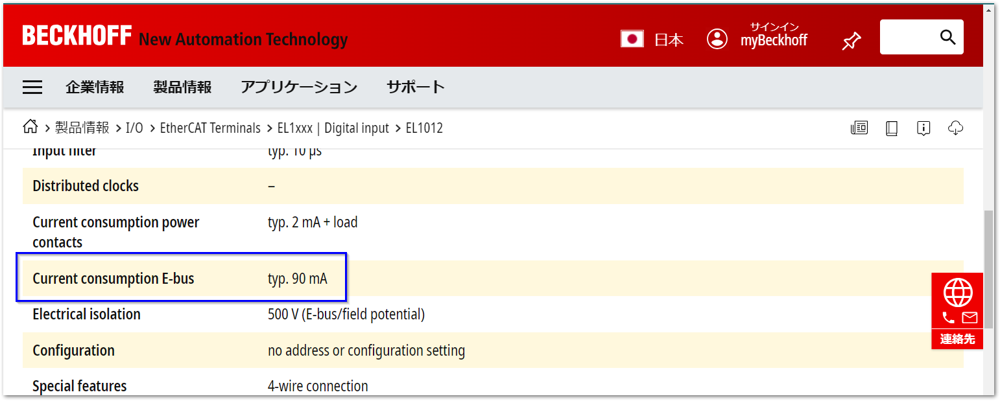
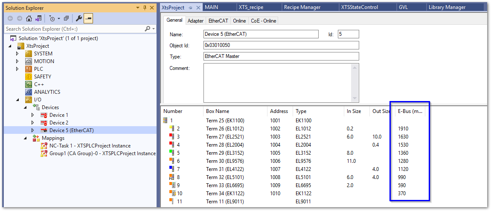

# ELターミナルの構成とカプラの選定方法と電源について

## Us (E-bus電源) について

EL/EDターミナルの制御電源（ $U_s$ ）に供給する電源は、EtherCATカプラ（EK1100など）の内部のDC-DCコンバータにより作られ、機種により変わりますが、おおむね2Aを最大供給能力としています。

[Current supply E-bus	2000 mA](https://www.beckhoff.com/ja-jp/products/i-o/ethercat-terminals/ek-ec1xxx-bk1xx0-ethercat-coupler/ek1100.html)

また、このカプラに接続されるEL/EDターミナルの電源消費定格は弊社サイトの製品仕様に `Current consumption E-bus` として示されています。

{align=center}


カプラに接続されたEL/EDターミナルの消費電流の合計値が、カプラの最大供給可能電流を超えた場合電圧降下が発生するなど正常に機能しなくなります。

```{warning}
さらに、EL/EDターミナルの種類によっては突入電流などの影響により、電源供給初期の立ち上がり時に著しい電圧降下が起こる可能性があります。カプラの供給可能電流の90%以内でご利用いただくようお願いします。
```

このE-bus消費電流の合計値の計算は手計算でも構いませんが、便利な機能としてTwinCAT上でEtherCATネットワークの構成を行うことで、EtherCATメインデバイスのGeneralタブで許容電流の一覧が表示できます。各ELターミナルの使用毎に消費する定格電流を差し引いた残留電流供給量を表示します。この値に余裕を持った構成となるようにしてください。

{align=center}

この値が概ね10%の余裕を持って配置頂く必要があります。これを越えてしまう直前では、次のとおりの電源供給ターミナルを別途設置してください。このターミナルはカプラと同様、内部にDC-DCコンバータを備えており、このターミナルより下流に設置されたEL/EDターミナルに向けた新たな電源グループを形成します。

```{csv-table}
:header: 型番, 供給電流, 備考
:widths: 1,2,7

EL9400, 2000mA, 電源供給のみ、短絡保護無し。旧機種です。新規非推奨です。
EL9410, 2000mA, 診断機能、短絡保護あり。新規手配はこちらをお選びください。
```

## 外部電源を取り出す

さまざまな電源を前面の端子から取り出す事が可能なターミナルがあります。前面のスプリングクランプ式の端子から取り合うものです。

EL918*シリーズは、 $U_p$ バスに供給された様々な電圧、AC/DCをそのまま取り出すものです。カプラから供給された電源以外のものを取り出すには、事前に上流側で対応する電源を別途接地し、$U_p$ に供給する必要があります。 詳しくは次節をご覧ください。

また、EL95** はターミナル内部で独立した電源供給回路を持っており、さまざまな電圧のUpとは絶縁された電源を取り出すことができるターミナルです。

用途が異なりますのでご注意ください。

```{csv-table}
:header: カテゴリ,型番,定格電圧（Technical Data）,前面端子の出力構成,接続方式,特徴・用途

電位分配ターミナル（パワーコンタクト直結）,EL9185,〜230 V AC/DC（任意電圧）,パワーコンタクト +側 × 4点、-側 × 4点（計8点）,スプリング式,最大230V AC/DCまで対応。100V/200V ACや48V DC等の電源取り出しも可能。
電位分配ターミナル（パワーコンタクト直結）,EL9186 / ED9186,≦ 60 V DC / ≦ 30 V AC,パワーコンタクト +側（24V等） × 8点（計8点）,スプリング式（EL） / プッシュイン式（ED）,プラス側電位のみを8点分配（48V DCまで対応、100V AC等は不可）。
電位分配ターミナル（パワーコンタクト直結）,EL9187 / ED9187,≦ 60 V DC / ≦ 30 V AC,パワーコンタクト -側（0V等） × 8点（計8点）,スプリング式（EL） / プッシュイン式（ED）,マイナス側電位のみを8点分配（48V DCまで対応、100V AC等は不可）。
電位分配ターミナル（パワーコンタクト直結）,EL9184 / ED9184,≦ 60 V DC,パワーコンタクト +側 × 8点、-側 × 8点（計16点）,プッシュイン式（HD）,1台で+側と-側のペアを8組取り出せる高密度モデル（60V DC以下専用）。
電位分配ターミナル（パワーコンタクト直結）,EL9188 / ED9188,≦ 60 V DC,パワーコンタクト +側 × 16点（計16点）,プッシュイン式（HD）,省スペース（幅12mm）で+側電位を16点分配（60V DC以下専用）。
電位分配ターミナル（パワーコンタクト直結）,EL9189 / ED9189,≦ 60 V DC,パワーコンタクト -側 × 16点（計16点）,プッシュイン式（HD）,省スペース（幅12mm）で-側電位を16点分配（60V DC以下専用）。
特殊電源ターミナル（電圧変換・絶縁）,EL9505 / EL9512 / EL9515,出力：5V / 12V / 15V DC（入力：24V DC）,変換後DC電源（最大0.5A）,スプリング式,24V DCから5V/12V/15V DCを生成し前面端子および下流パワーコンタクトへ出力。
特殊電源ターミナル（電圧変換・絶縁）,EL9560,出力：絶縁 24V DC（入力：24V DC）,絶縁24V DC電源（最大0.1A）,スプリング式,24V DC入力から電気的に絶縁された24V DCを生成し、前面端子および下流へ出力。
```

## Up 電源のアイソレーション

$U_p$ 電源の運用についても注意が必要です。E-busカプラのUpの電圧は標準的に24Vです。この電流自体はバスに流すことができる電流として10A程度までの負荷接続が可能です。

カプラから供給した電源は、カプラのED/EK接続面の側面に露出した `Power contacts` を通じてED/EKターミナルへ供給されます。


しかし、次の理由によりカプラから供給しているUpとは電源ラインを分離する必要性があります。

異なるバス電圧が必要となる場合
    : DC 24V以外のUpのコモン電源を用いたターミナルを必要とする場合、事前にその電源電圧を $U_p$ に必要とする電源を供給しておき、コモンバスを通じて電源稼働します。前節でご紹介したEL918*を使用する場合も同様に目的とする電源を別途 $U_p$ ラインに準備しておく必要があります。

電源を分離したい場合
    : NPN回路とPNP回路では、地絡発生時に安全側（オフ）へ動作させるための対策が異なります。0V側を保護接地（PE）に接続するPELV回路を採用する場合、安全回路にはPNP方式を用いるのが基本です（地絡時に負荷がオフになるため）。一方、NPN回路では0V側を接地すると地絡時に負荷がオンし続ける危険があるため、非接地（フローティング）とし、規格（IEC 60204-1 / JIS B 9960-1）に従って地絡検知器を設けるなどの対策が必要です。このように接地方式が異なる回路を混在させる場合は、電源を明確に分離し、それぞれの方式に適した地絡保護を行う必要があります。
    日本ではNPN出力方式での制御回路が一般的です。また、安全回路を組む場合PNP出力方式での回路と電源を分離する必要があります。弊社のTwinSAFEターミナルを用いる場合と`Ground switching`対象のELターミナル機器を同じカプラ上に配置する場合、この間の電源を分離するため、必ずその前後でEL9110などを挟み込んで $U_p$ 電源を分離する必要があります。

以上、これらを実現するための $U_p$ ラインを分離するためのターミナルをご紹介します。

```{csv-table}
:header: 型番,カテゴリ・役割,対応電圧 / 最大電流,診断機能,主な特徴・付加機能

EL9100 / ED9100,標準電位給電（24V DC）,24 V DC / 10 A,なし,最もベーシックな24V給電ターミナル（EDはプッシュイン式）
EL9110 / ED9110,標準電位給電（診断付き）,24 V DC / 10 A,あり,EL9100に電圧監視（2ビット入力）を追加した標準モデル
EL9185-0010,汎用電位給電＋分配,〜230 V AC/DC / 10 A,なし,新たな電位を給電しつつ、前面から各4点の電源取り出しが可能
EL9190,汎用電位給電（AC/DC対応）,〜230 V AC/DC / 10 A,なし,24V以外のDCや100V/200V ACの電位グループを作る場合に使用
EL9150,AC電位給電（LED付き）,120〜230 V AC / 10 A,なし,AC入力・出力ターミナル用の電位グループ形成（表示LED付き）
EL9160,AC電位給電（診断付き）,120〜230 V AC / 10 A,あり,EL9150に電圧監視の診断機能を追加したモデル
EL9200,ヒューズ付き電位給電,24 V DC / 6.3 A,なし,前面から交換可能なガラス管ヒューズ（6.3A）を内蔵
EL9210,ヒューズ＋診断付き電位給電,24 V DC / 6.3 A,あり,交換可能な6.3Aヒューズと電圧監視診断の両方を搭載
EL9250 / EL9260,AC用ヒューズ付き給電,120〜230 V AC / 6.3 A,EL9260のみ,100V/200V AC系統にヒューズ保護付きで電位グループを形成
EL9221 / EL9222 / EL9227,電子式過電流保護付き給電,24 V DC / 最大10 A,あり,1chまたは2chの電子ブレーカー内蔵（設定電流で遮断・リセット可能）
EL9400,E-busリフレッシュ＋給電,24 V DC / 10 A,なし,E-busへ2A供給しつつ、下流へ新しい24Vパワーコンタクトを供給
EL9410 / ED9410,E-busリフレッシュ＋診断給電,24 V DC / 10 A,あり,EL9400にUS・UPの診断機能を追加した標準リフレッシュターミナル
EL9540 / EL9550,サージフィルタ付き給電,24 V DC / 10 A,あり,雷サージやノイズ対策のフィルタを内蔵した電位給電ターミナル
EL9560,絶縁DC/DCコンバータ給電,24 V DC → 24 V DC / 0.1 A,なし,上流の24Vから内部で絶縁（500V）された24Vを生成し下流へ供給
EL9080,アイソレーション（遮断専用）,—（下流への給電なし）,なし,電源供給は行わず、上流からのUPバスバーを物理的に切るだけの絶縁端子

```