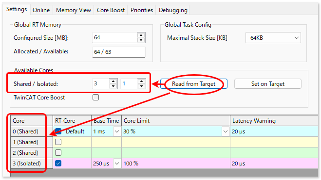
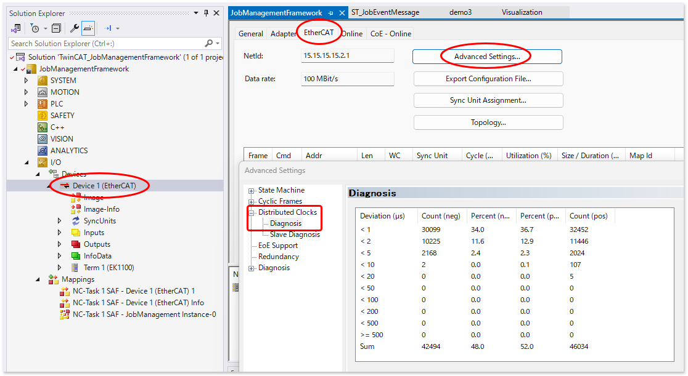

# CPUコアの独立（isolate）設定

TwinCAT XARがWindows上で動作している場合、CPUコアのShare/Isolateに設定は、`SYSTEM` - `RealTime` - `Settings` の `Set on Target` から設定変更を行い、XARが動作しているIPCのWindowsを再起動することでその設定が反映されます。

しかし、残念ながら TwinCAT RT Linux に対しては、TwinCAT XAEからCPUコアの独立設定を行うことはできません。Linuxのシェルへログインし、次のコマンドにて設定変更が必要となります。


```{code-block} bash
:caption: 4つのコアのうちSharedコアを3つに設定したい場合のコマンド
$ sudo TcCoreConf -s 3
```

このあと、IPCを再起動してください。再起動後は、次のコマンドによりisolatedされたコアの個数が分かります。

```{code-block} bash

$ cat /proc/cmdline
root=gpt-auto ro quiet splash rootwait intel_iommu=on iommu.passthrough=1 efi=runtime rd.luks=0 irqaffinity=0-2 isolcpus=3-N rcu_nocbs=3-N
```

isolcpus=3-N
    : 特定のCPUコアを通常（デフォルト）のOSスケジューラの負荷分散対象から除外（隔離）する設定です。これによりよりレイテンシの少ないリアルタイムタスクをこのコアに割り当てることで、アプリケーションのCPUアフィニティ設定によって常に固定でこのCPUコアを使用することが可能になります。（この設定はTwinCAT XAEのタスクのコア指定により指定可能です）
      この設定例では0から数えた3番目のコア以後の全てを指定しています。

rcu_nocbs=3-N
    : RCUとはCPUコアに割り当てられたカーネルスレッドが、使い終わったメモリ領域を解放処理するための仕組みです。この処理によってTwinCATに割り当てられているタスク処理が数マイクロ～数十マイクロ秒で中断し、ジッタの発生につながります。`rcu_nocbs` オプションは、この処理を行わなくするコアを指定します。この設定例では0から数えた3番目のコア以後の全てを指定しています。

上記設定を行った後、TwninCATからターゲットIPCへ接続した後の`SYSTEM` - `RealTime` - `Settings`にて`Read from Target` ボタンを押すと、Shared/Isolatedがコマンドで設定した内容へ反映されます。併せてモーションなどハードリアルタイムを必要とするタスクに対して、isolated 指定されたコアを割り当てる設定を行ってください。

{align=center}

モーションタスク等のディストリビューションクロックを用いるシンクユニットのジッタについては、`IO` - `EtherCAT main device` - `Advanced Settings...` - `Distributed Clocks` - `Diagnosis` に表示される統計情報からご確認いただけます。コア分離によりどの程度Jitterが解消されたかの評価のためにご覧ください。

{align=center}