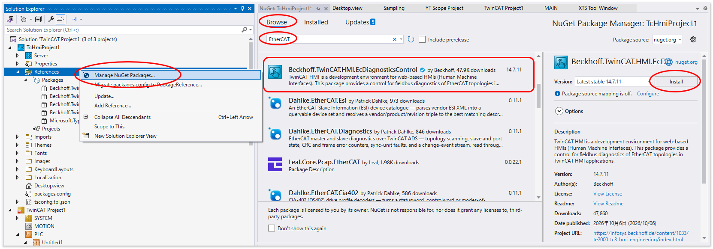
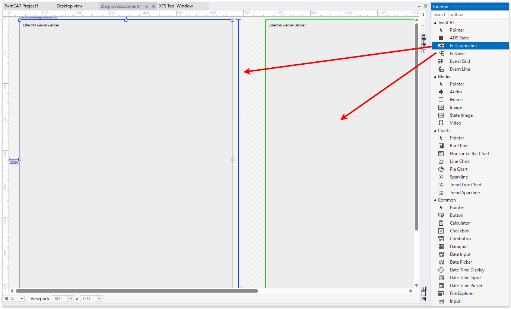
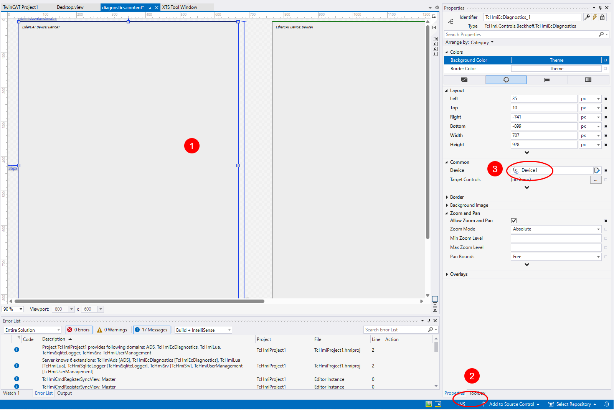

# EtherCAT 診断情報のビューコンポーネント

TwinCAT HMI上には、ホストしているTwinCATランタイムのEtherCATネットワークの診断情報を表示するビューコンポーネントが用意されています。

{align=center}

EtherCATの診断に関する情報は、{ref}`chapter_ethercat_diagnostics`も併せてご覧ください。

## インストール

TE2000　TwinCAT HMI プロジェクトの `References` > `Manage NuGet Packages...` を選択してください。BrowsタブからEtherCATの文字で検索して出現する、`Beckhoff.TwinCAT.HMI.EcDiagnosticsControl` をインストールします。

{align=center}

## 初期設定

下記の例の通り、Serverの設定ツリーにおいて、`TcHmiEcDiagnostics` を選択します。メイン画面に設定画面が現れますので、少なくとも`TargetNetId`と、`NasterNetId` の二か所のADSアドレスを設定します。

```{figure} assets/component_ec_diag_initial_setting.png
:align: center
:name: figure_tchmi_ec_diag_initial_setting

EtherCAT診断コンポーネント用のEtherCAT設定
```

TargetNetId
    : 監視する対象のIPCのADSルータのアドレスを設定します。TCP/IPまたはADS over MQTTにてルータ接続している他のIPCを設定することもできます。

MasterNetId
    : {numref}`figure_ec_main_device_ams_net_id`の`NetId`欄が、MasterNetIdに設定するべきAMS Net IDです。診断対象のEtherCATメインデバイスの設定項目のこの箇所を確認して設定してください。
      ```{figure} assets/component_ec_diag_ec_ads_addr.png
      :align: center
      :name: figure_ec_main_device_ams_net_id

      EtherCAT メインデバイスのAMS Net IDの調べ方
      ```

メインデバイスが複数ある場合、{numref}`figure_tchmi_ec_diag_initial_setting`の中の `+ Add` ボタンを押して監視対象のEtherCATメインデバイスを追加してください。この際のデバイス名（図の例では`Device1`）を作画時のプロパティで設定します。

## 作画方法

作画は非常に簡単です。次の2ステップで行ってください。

1. 作画画面において、ToolBoxから、`EcDiagnostics`と、`EcSlave`を選び、ドラッグアンドドロップにてキャンバス上に配置してください。
   {align=center}
2. 次に、配置したコンポーネントを選択し、右サイドバーの表示を下部のタブからToolBoxからPropertyへ切り替えます。
3. 中ほどの`Common` ツリーの中にある `Device` から診断対象のメインデバイスを選択します。{numref}`figure_tchmi_ec_diag_initial_setting` で設定したデバイス名を指定してください。
   {align=center}

## 使い方

作成したHMIを表示した例を{numref}`figure_tchmi_ecdiag_and_slave` に示します。左側は`EcDiagnostics`で、`EcSlave`コンポーネントの画面表示となります。

```{figure} assets/component_ec_diag_and_slave.png
:align: center
:name:figure_tchmi_ecdiag_and_slave

EtherCAT診断ビューとサブデバイスビューを並べた画面表示例
```

### 各デバイスの状態表示

EtherCAT診断ビュー `EcDiagnostics` は、EtherCAT ネットワーク全体の診断情報を表示するコンポーネントです。
EtherCATネットワークの各サブデバイスの上部には、塗りつぶし色でEtherCATステート状態が判別できます。吹き出しにて示すそれぞれの状態が対応します。

```{figure} assets/component_ec_diag_status_display.png
:align: center
:name: figure_tchmi_ecdiag_status_display

EtherCAT診断ビューにおける各サブデバイスの状態表示例
```

### ENI構成定義の妥当性

ENIで定義されたEtherCATネットワークと実際の構成が異なる場合の表示について示します。

{numref}`figure_ec_diag_caseof_excessive_device` は、ENIで定義されたデバイスよりも、実際接続されたデバイスが **多い** 場合の表示例です。実際は {numref}`figure_tchmi_ecdiag_status_display` と同じ構成のデバイスが接続されています。この状態からTwinCATの構成定義を変更して `Term10 EL2004` を無効化しました。これによりENI定義は実際のものよりもEL2004の部分が少ないことになります。

また、Term10 EL2004のもともとのEtherCATアドレスは `1005` だったのですが、前に詰められて 次の EL6652 がEtherCATアドレス `1005` となりました。このため、EL6652 は本来 EL2004であるはずなのですが、デバイスのVPRS（Vendor ID、Product Code、Revision Number、Serial Number）情報の整合が取れないため、INITのままとなっています。

```{figure} assets/component_ec_diag_caseof_excessive_device.png
:align: center
:name: figure_ec_diag_caseof_excessive_device

ENIよりも実際の構成が多い場合の表示例
```


{numref}`figure_ec_diag_caseof_lack_device` は逆に、ENIで定義されたデバイスよりも、実際の構成が **少ない** 場合の表示例です。ENIで定義した同じくEtherCATアドレス 1005 の `Term10 EL2008` は実際には存在しません。この場合の表示も、実際に検出した VPRS情報がその次の EL2004 となっているため整合が合わず、INITのままとなっています。

```{figure} assets/component_ec_diag_caseof_lack_device.png
:align: center
:name: figure_ec_diag_caseof_lack_device

ENIよりも実際の構成が少ない場合の表示例
```

{numref}`figure_ec_diag_caseof_lack_device` に対して実際のデバイス構成と合致するよう、TwinCAT上の定義ファイルで余計なデバイスを無効化させた例が、{numref}`figure_ec_diag_valid_eni` です。この場合、全てのデバイスが問題なくOP状態となります。

```{figure} assets/component_ec_diag_valid_eni.png
:align: center
:name: figure_ec_diag_valid_eni

実際の構成に合うようにTwinCAT上でデバイスを無効化させた場合
```

### サブデバイスの診断情報

サブデバイスビュー `EcSlave` は、特定のサブデバイスの状態、および、操作を可能にするビューです。

ネットワーク全体部
    : {numref}`figure_subdevice_view_overview` の通り、EtherCATネットワーク全体を表示します。任意のデバイスを選択すると、ここより下部にそのデバイスの診断情報の詳細を表示します。デバイスの下部には、表形式で次のカウンタが表示されます。

      Abnormal state changes
        : メインデバイスからの状態遷移（例えばPREOP > OP）への遷移に失敗した回数

      Connection losses
        : Ethernetの物理的な接続が検出できない状態を検出した回数。

      CRC Error
        : EtherCATサブデバイスが持つ各ポートに受信したフレームのCRCチェックでエラーが発生した回数。

```{figure} assets/component_subdevice_view_overview.png
:align: center
:name: figure_subdevice_view_overview

サブデバイスビューのネットワーク全体部
```