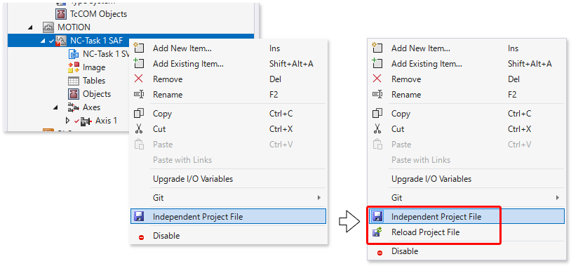

# TwinCATプロジェクトの設定準備

各種設定ファイルは、なるべく個別に分離しておくとよいでしょう。その理由は、開発環境のプロジェクト構成に格納される情報は大きく分けて次の二つの情報に分かれていて。この単位で分離しておくことでチーム開発者間におけるプロジェクトデータの分岐やマージへの影響が最小限になるためです。

開発環境の設定関連データとシステム関連データ
    : システム設定（タスク、Real time）、接続先のターゲットなどの開発環境設定データ。

設計データ
    : プログラム構成、モーション設定ファイル、IO設定ファイル、リンク情報など

これらを統合しているのは、TwinCATプロジェクトのメタファイルである`tsproj`ファイルです。

## tsprojファイルの定義から設計データを独立させる

tsprojファイルには開発環境の設定データも含むため、開発者の環境によってデータが変化します。これが、Git等でチームで開発する場合、個々の変更をマージする際に意図しない競合エラーにつながることがあります。そこで、tsprojデータからは、「設計データ」を除外して、独立した定義ファイル化することが可能です。

この設定は、TwinCAT の開発環境のメニューから `Tools` > `Options..` のツリー、メニューから、`TwinCAT` > `XAE Environment` > `File settings` を選択した箇所にあります。

この設定項目のトップには、まず、`Enable Multipe Project Files` があり、これをTrueに設定してください。続いて、独立させたい各項目について選択的に`True`を設定すると独立させることが可能になります。対応するプロジェクトツリーの関係を示した図を {numref}`figure_enable_separate_files` に示します。

```{figure} assets/separate_files.png
:aign: center
:name: figure_enable_separate_files

定義ファイルの独立の有効設定と対応する項目
```

対応する項目のソリューションツリー上に選択ハイライトされた箇所を右クリックして現れるコンテキストメニューには、下部に `Independent Project File` という項目があります。これを選択すると、各メニューや、`True`に設定したサブメニューの項目がフロッピーディスクのイラストでオーバレイされたアイコンとなります。

{align=center}

これらを設定する前と後で比較したものが　{numref}`figure_separate_files_diff` です。tsprojファイルの内容は、実際はXML形式のテキストファイルですが、TwinCATの差分ビューワを通すとプロジェクトツリー形式で表示されます。このツリーが2ペインで変更前後で比較表示されています。変更後の`tsproj`ファイルからは、独立設定した定義項目が消滅し、代わりに`xti`ファイルが定義されていることが分かるでしょう。また、プロジェクトツリーには、独立して新規に生成された `xti` 定義ファイルが追加マーク（A）で一覧され、TwinCATプロジェクトフォルダ内の `_Config` フォルダ以下に各々のサブプロジェクト名ごとに保存されていることがわかります。

```{figure} assets/separate_files_diff.png
:align: center
:name: figure_separate_files_diff

設定ファイル独立前後の比較
```

